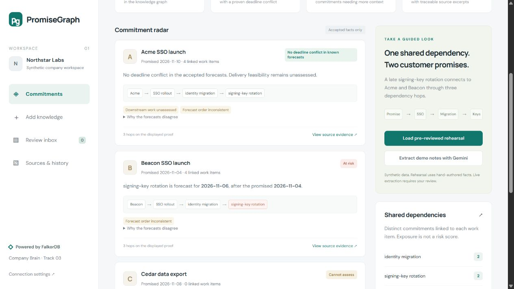
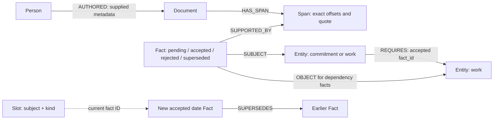

# PromiseGraph

**Trace customer promises to the work, decisions, and source evidence behind them.**

**[Open the live app →](https://promisegraph.onrender.com/)**

Track: **03 — Company Brain** · Graph Hacks / WeMakeDevs × FalkorDB · October 2026

A promise made in a customer call can depend on work several tickets away. PromiseGraph extracts proposed facts from notes, tickets, and chat, asks a person to review them, then follows accepted dependencies in FalkorDB. A bounded Gemini agent chooses which commitments to assess and which source excerpts to open. Code computes the deadline conflicts; the model explains them.

In the synthetic example, both Acme and Beacon depend on signing-key rotation through three hops. Its forecast is later than both customer deadlines. Accepting an explicit Acme deadline replacement changes Acme's verdict, preserves the earlier decision, and leaves Beacon at risk. Cedar has no known linked work and remains **Cannot assess**.

**Verified build:** 84 Python tests passed, including 27 access-control/request-limit tests and 6 FalkorDB Cloud integration tests, plus 16 deterministic JavaScript interface tests. Live Gemini extraction, evidence tool calls, supersession, and app-restart persistence were checked previously; protected HTTP access was checked on October 18. [Detailed results and limitations](docs/verification.md) · [Submission checklist](docs/submission.md).

The latest natural-note demonstration extracted all 14 expected proposals across five documents with valid source spans. Its live agent completed without fallback. Three earlier attempts exposed invalid model proposals and are preserved, so this successful development replay is not an accuracy estimate. [Saved run](docs/natural-demo-run.json). Fresh browser verification of the interface refinements was blocked. [Submission readiness review](docs/submission-readiness-review.md).




## Run without Docker

Requirements: Python 3.12, a FalkorDB instance (Cloud is supported), and a Gemini key for live extraction and agent calls. See [the illustrated-in-app setup flow and written instructions](docs/setup.md).

```powershell
python -m venv .venv
.\.venv\Scripts\python.exe -m pip install -r requirements.txt
Copy-Item .env.example .env
# Fill in .env with your Gemini key and FalkorDB Cloud connection details.
.\.venv\Scripts\python.exe -m uvicorn app.main:app --host 127.0.0.1 --port 8000 --workers 1
```

Open **http://127.0.0.1:8000**. Do not overwrite an existing `.env`. The convenience launchers `start.ps1` and `start.sh` create it only if absent.

The local UI loads without credentials, but it does not fabricate graph results. A failed database operation is an error, never an empty successful assessment. The app is a **shared-workspace prototype**. Hosted demos now support a password gate and bounded request rates; Render and production mode refuse to start without credentials. Follow [protected hosting setup](docs/hosting.md) before exposing it. This does not provide separate user accounts or tenant permissions.

An optional `PUBLIC_DEMO_UNTIL` timestamp temporarily allows public access while
retaining all request limits. The same process restores the password requirement
on expiry. This exposes the shared synthetic workspace, including editing and exports;
it does not create separate visitor workspaces. See the hosting guide for setup.

For the exact dependency versions resolved during verification, install `requirements-lock.txt`. Check configuration without exposing credentials using `python -m scripts.check_connection`. Package the source without `.env` using `python scripts/package.py --out ../PromiseGraph-submission.zip`.

### Optional Docker database

Cloud users can skip this. With Docker installed, run `docker compose up -d` in this folder. Use localhost, port 6379, username `default`, an empty password, and `FALKORDB_SSL=false` in `.env`. The Compose file binds the database only to loopback and persists data in a named volume. Its server image is pinned to `v4.20.7`; Cloud runs the version provided by your instance. Record the actual server version when running the integration checks.

## Demonstrate the vertical slice

1. **Load pre-reviewed rehearsal** inserts labeled, hand-authored synthetic fixtures into FalkorDB. This is useful without a Gemini key and is explicitly not live extraction.
2. See two at-risk commitments and one unlinked commitment. Open a source excerpt and the three-hop dependency path.
3. Go to **Add knowledge → Queue rehearsal revision**. Confirm the old/new date in **Review inbox** and accept the replacement.
4. Acme changes to **No deadline conflict in known forecasts**. Beacon stays **At risk**. The forecast-order inconsistency remains visible.
5. Run the scripted rehearsal agent or the live Gemini agent. The trace labels where each tool selection came from.

For a genuine model demonstration, use a fresh graph name, click **Extract demo notes with Gemini**, review the returned proposals, and then extract the revision note live. The rehearsal and live ingestion modes cannot silently replace each other for the same document.

The examples are synthetic customer call notes, an engineering handoff ticket, and a platform chat, with ordinary surrounding context. They deliberately retain full dates and approved entity names. Editing their displayed text is not a data migration: changed notes must be extracted again in a fresh graph so quotes, offsets, and model records stay consistent.

In an empty live **Review inbox**, **Try reviewing a sample** fills a Cedar deadline revision in **Add knowledge**. Inspect it, click **Extract with Gemini**, then accept or reject the actual pending proposal. Accepting changes only Cedar's deadline; its missing work links still prevent a feasibility assessment. A processed sample links back to sources instead of creating duplicate proposals. The rehearsal inbox offers an explicitly labeled hand-authored Acme revision.

Each commitment card lists **People with relevant context**, derived from authors attached to accepted deadline, dependency, and forecast evidence on its displayed path. Click a person's source chip to inspect the exact quotes. Authorship and role are supplied metadata, not proof of work ownership or a team impact calculation.

The answer's numbered **Observed tool calls** show the selected scope and source IDs. Each assessment step contains its own executed Cypher, parameters, and timings. Evidence-opening steps link the retrieved quotes and state that they issue no additional database query. These are recorded operations, not hidden model reasoning.

## Graph data model



Documents include original text, source type, author ID, document timestamp/timezone, extraction mode, model, prompt hash, raw model response, and processing state. Fact nodes hold review state and normalized values. Span nodes retain exact source offsets. Slot nodes guard the one-current-value invariant. Approved identities and aliases are seeded from `data/entities.json`; these are configuration, not a second fact database.

`Entity` uses a `kind` property (`commitment` or `work`); there are no separate `Commitment` or `WorkItem` labels. The diagram's dotted Slot link denotes a `current` property containing a fact ID, not a stored relationship. People are `Person` nodes; roles are properties, and Team nodes are not implemented.

All authoritative knowledge, review state, provenance, and supersession history live in FalkorDB. There is no SQLite/Postgres mirror and no in-memory product fallback.

## Why the graph is essential

- [`paths.cypher`](app/queries/paths.cypher) traverses **variable-length** accepted `REQUIRES` paths (up to eight edges), including branches, shared work, and multiple routes. These returned rows determine the reachable forecasts and conflict proof paths.
- [`evidence.cypher`](app/queries/evidence.cypher) connects fact → span → document → supplied author. Every displayed conflict opens its deadline, forecast, and dependency sources through this graph query.
- [`supersede.cypher`](app/queries/supersede.cypher) checks the current slot and expected earlier fact, switches the active value, and records `SUPERSEDES` in one guarded write. The graph retains the earlier source instead of overwriting it.
- [`history.cypher`](app/queries/history.cypher) retrieves the replacement trail. The shared-dependency exposure count deduplicates commitments over the graph's returned paths; it is not an at-risk count.

Removing FalkorDB removes storage, traversal, review promotion, provenance, and decision history. The UI alone cannot compute the product's answers. Other databases could implement related operations; the claim is that this implementation centrally depends on the graph, not that SQL is incapable of traversal.

### Core queries and computation boundary

The actual parameterized traversal in [`paths.cypher`](app/queries/paths.cypher) returns variable-length paths, including the demo's three-hop proof. `$id` is a commitment ID. The extra row detects the 200-path limit.

```cypher
MATCH p=(c:Entity {id:$id})-[:REQUIRES*1..8]->(w:Entity)
RETURN [n IN nodes(p) | n.id] AS node_ids,
       [r IN relationships(p) | r.fact_id] AS fact_ids
LIMIT 201
```

[`evidence.cypher`](app/queries/evidence.cypher) retrieves actual source spans and supplied authors for the selected `$ids`:

```cypher
MATCH (f:Fact)-[:SUPPORTED_BY]->(s:Span)<-[:HAS_SPAN]-(d:Document)
WHERE f.id IN $ids
OPTIONAL MATCH (p:Person)-[:AUTHORED]->(d)
RETURN properties(f), properties(s), properties(d), properties(p)
```

[`supersede.cypher`](app/queries/supersede.cypher) preserves the old fact and guards against stale replacements. Parameters identify the pending fact, expected earlier fact, slot, review time, and review reason.

```cypher
MATCH (f:Fact {id:$id}), (old:Fact {id:$old_id}), (s:Slot {id:$slot})
WHERE f.status = 'pending' AND old.status = 'accepted'
  AND size(f.validation_flags) = 0
  AND s.current = old.id AND f.slot_id = s.id AND old.slot_id = s.id
  AND f.kind = old.kind AND f.subject_id = old.subject_id
  AND f.kind IN ['deadline','forecast'] AND f.old_date = old.date
SET f.status = 'accepted', f.reviewed_at = $now, f.review_reason = $reason,
    old.status = 'superseded', old.reviewed_at = $now, s.current = f.id
MERGE (f)-[:SUPERSEDES]->(old)
RETURN f.id
```

[`risk.py`](app/risk.py) consumes these graph results. It selects accepted date facts, checks each against its Slot's current fact ID, validates supporting paths, and excludes superseded facts from risk calculation. It compares reachable forecasts against deadlines. For consecutive work forecasts, `_forecast_order_conflicts` flags a dependent scheduled before its prerequisite. This forecast-order check runs in Python, not a separate Cypher algorithm. History can still display superseded evidence. No `algo.SPpaths`, centrality, or other named graph algorithm is claimed.

### Named graphs and isolation

`FALKORDB_GRAPH` selects one named graph for this app process. Rehearsal, live demonstration, and integration scenarios use separate names on one FalkorDB instance; each integration test creates a unique `pg_test_...` graph and deletes only that test graph. This keeps their records separate. The sidebar's “Workspace 01” is a display label, not tenant routing. Hosted authentication is one shared demo login; per-tenant authorization and concurrent multi-user isolation are not implemented.

## Deterministic status and uncertainty

| Primary status | Rule |
| --- | --- |
| `at_risk` | At least one accepted reachable work forecast is later than the accepted commitment deadline, with a valid source-backed path. |
| `unknown` | No proven conflict, but required evidence is missing, pending, ambiguous, cyclic, truncated, or otherwise incomplete. |
| `no_known_conflict` | No accepted reachable forecast exceeds the deadline and the known traversal has no blocking gaps. Always includes the downstream-work limitation. |

Evidence flags are independent of the primary status: a proven late branch remains at risk even if another branch has a missing forecast. A missing dependency path is **no known path**, not evidence of safety.

An informational `forecast_order_conflict` compares consecutive forecasts: a dependent forecast earlier than its prerequisite is inconsistent. This flag does not change the deadline verdict. It persists after Acme's deadline moves. Forecasts are not a scheduling model: remaining work, lag, capacity, calendars, and delivery feasibility are unassessed. Dependency semantics are required prerequisites only, not optional alternatives.

The traversal bounds are eight edges and 200 returned paths per commitment, plus one sentinel row to detect overflow. Cycles and boundary continuation produce uncertainty flags. Read operations use `GRAPH.RO_QUERY` with a 1,000 ms timeout; the client also has connection/socket timeouts. A socket timeout does not prove a write rolled back. On an uncertain write, reload the fact and current slot before retrying.

## Extraction, review, and the agent

- Strict proposal schema, exact unique quotes, span offsets, literal date-in-quote checks, full explicit calendar dates, and exact approved aliases.
- Unknown names, shorthand/relative dates, ambiguous spans, and negated/tentative assertions are blocked from acceptance. Quote matching does not establish semantic correctness; a person must inspect each proposal.
- Every live proposal starts pending. The only auto-accepted data is the explicitly pre-reviewed, hand-authored baseline rehearsal.
- New scalar dates cannot silently overwrite accepted values. A replacement must quote the earlier date, contain an explicit replacement cue, match the current fact, and receive a separate confirmation.
- A process lock serializes writes and consistent reads within **one worker**. Supersession uses a single guarded Cypher write. No cross-process transaction or multi-user concurrency guarantee is claimed.
- The Gemini loop can call only `assess_commitments` and `read_evidence`, at most four calls. IDs and citations are checked; unsupported tool names are rejected. No arbitrary text-to-Cypher or agent write tool exists.
- The trace contains observed tool names, arguments, and results, never hidden reasoning. A model failure after computation retains the computed results and labels the templated fallback. A failed live extraction never substitutes fixture facts.
- Authorship is user-supplied metadata. It is not an extracted ownership claim. Teams are roster metadata; organization-wide ownership reasoning is outside this prototype.

## Evaluation

```powershell
# Pure deterministic logic, validation, agent protocol and API failure tests
python -m pytest -q

# Interface state and safe rendering (requires Node.js with node:test support)
node --test tests/frontend.test.cjs

# Actual FalkorDB integration; needs a configured reachable instance
$env:RUN_GRAPH_TESTS = '1'
python -m pytest -q -m integration

# Hand-authored fixture pipeline check — NOT model extraction accuracy
python -m eval.run --fixtures --out eval/runs/fixture-check.json

# Nominate a new output name before inspecting the score
python -m eval.run --fresh --out eval/runs/live-01.json
# Replay that run without an API request
python -m eval.run --replay eval/runs/live-01.jsonl --out eval/runs/replay-01.json
```

On macOS/Linux use `RUN_GRAPH_TESTS=1 python -m pytest -q -m integration`.

The seven-note set contains eight expected proposals/deferrals and is **self-authored development data**, not an independently authored held-out benchmark. The initial extraction prompt existed before these labels, so no pre-prompt holdout claim is made. Two extra development notes are separate. The script reports correct, incorrect, missed, deferred, missing expected deferral, and failed-note counts, plus failures. It never combines model extraction with human review into an accuracy percentage.

Fresh runs save input, raw response (including failed schema outputs), model, prompt hash, schema version, temperature, and dataset hash. Replay verifies downstream processing of saved outputs. It does not prove the model would repeat those outputs. Existing evaluation reports are not overwritten. The UI's graph export also includes original model responses from document ingestion.

The latest checked-in Gemini 3.5 Flash-Lite run with the complete-quote prompt returned usable outputs for all seven development notes: **5 correct, 3 deferred, 0 incorrect, 0 missed, and 0 provider failures**. Saved-response replay reproduced those counts. See [live-extraction-04-natural-prompt.json](docs/live-extraction-04-natural-prompt.json) and its raw-response JSONL. The earlier paced run had one HTTP 503; that run, the other provider failures, and the three failed natural-demo attempts remain preserved. These tiny, self-authored samples do not establish a general accuracy rate or model ranking. A temporary 502/503/504 gets one bounded retry; 429 is surfaced immediately rather than retried in a burst.

Database tests create one exact `pg_test_<uuid>` graph per scenario and delete only the graph owned by that fixture. They test read-write separation, real three-hop traversal and provenance, ingestion idempotency, conflicting updates, guarded supersession/retry/stale requests, reconnect persistence, and bounded cyclic traversal. Pure fixtures separately test deeper chains, parallel paths, depth boundaries, and positive proof with missing evidence. See [verification status](docs/verification.md) and [coverage map](docs/coverage.md). Skipped tests are not passing integration tests.

## Implementation map

`app/ingest.py`: aliases, dates, spans · `app/graph.py`: database, guarded review · `app/risk.py`: deterministic assessment · `app/llm.py`: Gemini structured extraction · `app/agent.py`: bounded tools · `app/service.py`: ingestion/assessment coordination · `app/main.py`: FastAPI routes · `app/static/`: interface · `eval/`: extraction evaluator · `tests/`: validation and integrity checks.

## Limits and deliberate cuts

This is a focused prototype with a small approved entity roster and synthetic source data. It has no external Jira/email integrations, auto-send, task automation, relative-date resolution, fuzzy entity merging, full temporal queries, or general-purpose company search. A completed source is immutable in the UI; submit a new correction document or use a fresh demo graph. A process interrupted during extraction can leave a document marked extracting, which remains visible as a gap. Large graph workloads and concurrent multi-client writes require additional work.

## AI assistance and participant contribution

OpenAI Codex substantially assisted implementation, UI, tests, and documentation. The participant supplied the project concept, detailed failure analysis, scope decisions, and implementation requirements. Submission requires the participant to run and verify the app, inspect the actual results, understand the risk logic and guarded queries, and accurately describe their contribution. Do not claim hand-written implementation or verification that has not happened.

All Northstar Labs, customer names, people, notes, and tickets are synthetic. Fonts use Google Fonts with local system fallbacks. No real customer data is required.

## Submission

See [submission checklist](docs/submission.md). Supply a public source repository, this README and Cypher, a working demo video, local setup instructions (or a deployment), and **Track 03 — Company Brain**. A UI-only recording without a connected graph is not a successful product demonstration. [Official event rules](https://www.wemakedevs.org/hackathons/falkordb/rules).
